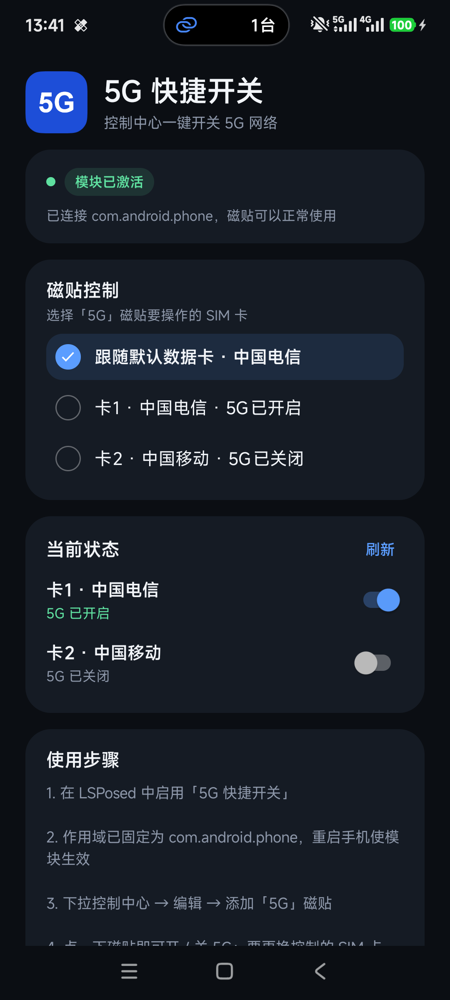
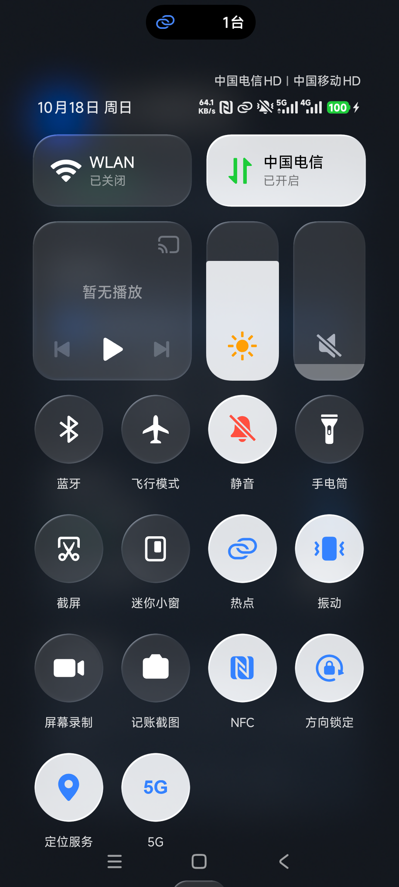
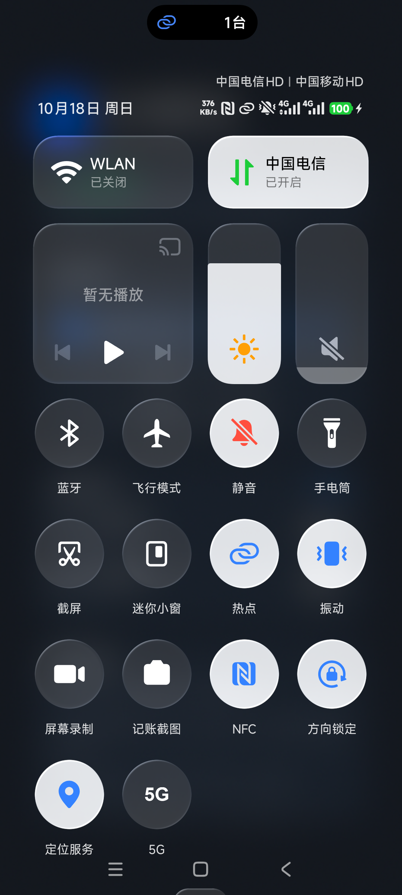

# 5G 快捷开关

在控制中心加一个「5G」磁贴，点一下就能开 / 关 5G，不用再进
`设置 → 移动网络 → 5G网络`。

| 5G 已开启 | 5G 已关闭 |
| --- | --- |
|  |  |

## 功能

- 控制中心「5G」磁贴一键开关 5G
- 磁贴状态实时反映当前 5G 开关
- 支持双卡：默认跟随默认数据卡，也可以指定卡 1 / 卡 2
- 应用内可直接开关每张卡的 5G
- 不需要任何运行时权限

## 已验证环境

- 机型：Xiaomi 13（2211133C / fuxi）
- 系统：HyperOS 4.0（OS4.0.24.0.XEOCNXM）/ Android 17（API 37）
- LSPosed：2.2.1（7912），API 102
- 卡 1 中国电信：磁贴切换后 `fiveg_user_enable` 1 ↔ 0，NR 网络类型同步增删
- 卡 2 中国移动：双卡 5G（dual NR）通过模块切换，`dual_nr_enabled` 0 ↔ 1

> 卡 2 的 5G 属于“双卡 5G / 双 NR”，需要先开启默认数据卡的 5G；
> 不满足时磁贴会提示「请先开启默认数据卡的 5G」。

## 安装

1. 安装本仓库 Release 中的 APK。
2. 打开 LSPosed → 模块 → 启用「5G 快捷开关」。
   作用域已固定为 `com.android.phone`（`staticScope=true`），无需手动勾选。
3. 重启手机（或重启电话服务进程）让模块注入。
4. 下拉控制中心 → 编辑 → 添加「5G」磁贴。
5. 点磁贴即可开关 5G；要切换控制的 SIM 卡，打开应用选择。

## 实现方式

模块使用 LSPosed API 102，只注入 `com.android.phone`：

- 入口继承 `io.github.libxposed.api.XposedModule`
- `META-INF/xposed/module.prop`：`minApiVersion=102`、`targetApiVersion=102`、`staticScope=true`
- `META-INF/xposed/scope.list`：`com.android.phone`
- `META-INF/xposed/java_init.list`：入口类
- 在 `onPackageLoaded()` 中 hook `Application.onCreate` 和
  `Instrumentation.callApplicationOnCreate`，取得电话进程 Context 后注册广播桥

HyperOS 的 5G 开关由电话进程里的 `com.android.phone.FiveGManager` 完成，
系统设置页 `MiuiFiveGNetworkSetting` 也是调用它的
`setUserFiveGEnabled(boolean, phoneId)`。模块通过反射调用同一个入口，
因此行为与系统设置页一致（包括双卡 / 双 NR 逻辑）。

非 HyperOS 环境会回退到 AOSP 公开 API
`TelephonyManager.setAllowedNetworkTypesForReason(ALLOWED_NETWORK_TYPES_REASON_USER, ...)`。

磁贴部分是一个标准 `TileService`，自身没有特权权限，只通过广播与电话进程通信；
电话进程内的接收器会校验发送方 UID。

## 更新日志

### 1.0.0

- 首个版本
- 支持控制中心 5G 磁贴
- 支持默认数据卡 / 指定 SIM 卡
- 支持 HyperOS 4 / Android 17，LSPosed API 102

<!-- updated -->
